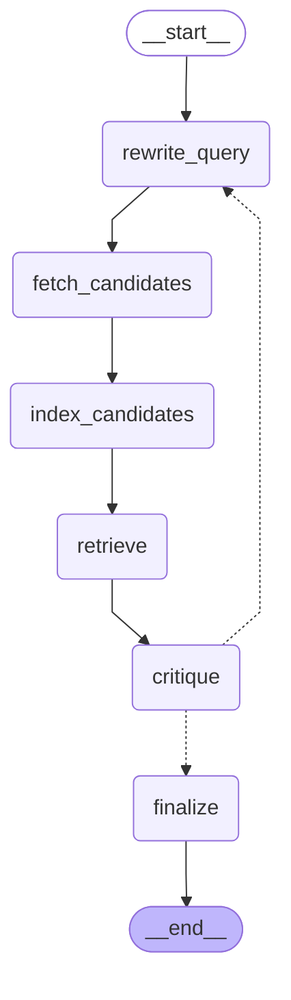

# Research Paper Recommender

An agentic RAG app: a research question goes in, and a ranked list of arXiv papers comes out, each with a one-line reason it is relevant.

Stack: Python 3.12, LangChain + LangGraph, Pinecone, sentence-transformers (SPECTER), OpenAI, FastAPI.

## Setup

Requires Python 3.12+.

```bash
python3.12 -m venv .venv
source .venv/bin/activate
pip install -e ".[dev]"
cp .env.example .env   # then fill in OPENAI_API_KEY and PINECONE_API_KEY
```

`pip install -e .` installs the `app` package in editable mode, so code changes take effect without reinstalling. The `[dev]` extra adds pytest and ruff.

## Usage

Run from the repo root.

```bash
# Fetch papers from arXiv, embed them and upsert them into Pinecone
python scripts/ingest_arxiv.py --query "graph neural networks" --max 200

# Re-ingest every cached paper without calling arXiv (optionally into another embedder's index)
python scripts/ingest_arxiv.py --from-cache --embedder scincl

# Rebuild data/papers.jsonl from an existing index (merges; no arXiv or OpenAI calls)
python scripts/export_cache.py --index papers-openai-1536

# Search the index
python scripts/search.py "message passing for molecules" --k 5 --year-min 2022
python scripts/search.py "protein folding" --category q-bio.BM --category cs.LG

# Compare top-k results from each embedder side by side (queries from docs/benchmark_queries.txt);
# writes docs/embedding_comparison.md. Each embedder's index must be ingested first.
python scripts/compare_embedders.py --k 5

# Recommend papers: runs the agent loop and prints each iteration's queries, then the top 5
python scripts/recommend.py "message passing GNNs for molecules"
python scripts/recommend.py "protein language models" --max-iterations 2
# Skip arXiv and use only the existing index (when rate-limited, or for demos)
python scripts/recommend.py "message passing GNNs for molecules" --no-fetch

# Regenerate the agent diagram in docs/graph.md (run after changing app/graph.py)
python scripts/draw_graph.py
```

The index is named after the embedder (for example `papers-openai-1536`) and is created on first ingest. Set `EMBEDDER` in `.env` to choose the embedding model (default `openai`). `--embedder NAME` overrides it for one ingest run.

Every arXiv fetch is also appended to `data/papers.jsonl` (one paper per line, de-duplicated by arXiv ID). That folder is git-ignored.

## How the agent works



1. **rewrite_query:** the LLM turns the question (plus any critique feedback) into 1–3 arXiv queries (`ti:`, `abs:`, `cat:`, `AND`/`OR`).
2. **fetch_candidates → index_candidates:** about 20 papers per query are fetched from arXiv and upserted into Pinecone. If arXiv fails, the agent logs a warning and keeps going with what is already indexed.
3. **retrieve:** vector search for the top 10 papers, always with the *original* question, so the ranking stays tied to what you asked.
4. **critique:** one LLM call grades all 10 papers (relevant or not, plus a one-line reason) and says what's missing.
5. **Loop or finish:** with 5+ relevant papers, or after `--max-iterations` passes (default 3), **finalize** returns the top 5 relevant papers by vector score. Otherwise it loops back to step 1 with the feedback.

## Embedders

| `EMBEDDER` | Model | Index | Runs |
|---|---|---|---|
| `openai` (default) | `text-embedding-3-small` | `papers-openai-1536` | OpenAI API |
| `scincl` | [`malteos/scincl`](https://huggingface.co/malteos/scincl) | `papers-scincl-768` | locally |
| `specter` | [`sentence-transformers/allenai-specter`](https://huggingface.co/sentence-transformers/allenai-specter) | `papers-specter-768` | locally |

The local models run with sentence-transformers on Apple's GPU (`mps`) when available, otherwise on the CPU. The first use downloads the model (about 440 MB) into the Hugging Face cache. Each embedder formats papers the way its model was trained: OpenAI gets `title\n\nabstract`, and SciNCL/SPECTER get `title[SEP]abstract`.

**Why not SPECTER2?** SPECTER2 needs the `adapters` library, and even its newest release (1.3.0) requires `transformers~=4.57`. This project uses sentence-transformers 6, which requires transformers 5. We can add SPECTER2 once `adapters` supports transformers 5.

## Development

```bash
pytest -q
ruff check app tests scripts && ruff format app tests scripts
```
